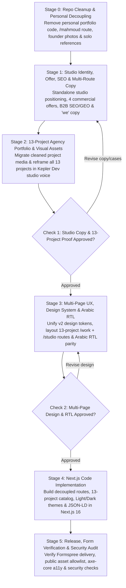

# Kepler Dev Agency Portfolio — Production Lifecycle (Overview)

**Goal:** Transform `https://www.keplerdev.uk/` into a standalone, high-conversion B2B digital product studio website with **its own independent studio identity** (completely decoupled from Mahmoud's personal identity, keeping only the temporary fallback email), showcasing **all 13 studio & engineering projects** (6 deep-dive flagship case studies + 7 structured R&D/system showcase builds), unified Light/Dark visual styling, and full English + Arabic RTL parity.

---

## High-Level Flow

---

## Core Architectural Rules for Kepler Dev

1. **100% Standalone Studio Identity (Zero Personal Attribution):**
   - **Kepler Dev** speaks exclusively as an independent UK & GCC digital product studio (`"we"`, `"our"`, `"Kepler Dev"`, `"our engineering team"`).
   - **No Personal Bio or Portraits:** No `/mahmoud` page, no `"Founder-led"` sections, no personal portraits (`founder-portrait*`, `founder.webp`), no `"Mahmoud Mohamed Attia"` name in visible copy, case study roles, or JSON-LD `@type: "Person"` structured data.
   - **Temporary Contact Exception:** `mahmouddattiaa7@gmail.com` may remain solely as the configured fallback email address until a domain inbox (`hello@keplerdev.uk`) replaces it.
2. **All 13 Projects Included Under the Studio Umbrella:**
   - **6 Flagship Case Studies (`/work/[slug]`):** `Glitre Loyalty Platform`, `HS VPN`, `Faseeh AI Keyboard` (`Aksira`), `Classroom Sentinel`, `StayEase`, and `MedConnect Egypt`.
   - **7 Studio Showcase & R&D Builds (`/work` Grid):** `QuickChargingPOS`, `FitForge`, `Qiraaty`, `AI Collab Platform`, `Focus Ritual`, `GetLab System`, and `AgencyOS`.
   - Every project is presented as a **Kepler Dev studio build or internal R&D system** (never framed as university coursework or solo freelancing).
3. **Consequence First, Mechanism Second:**
   - Every project and service page speaks to two readers at once: plain operational/commercial outcomes for business owners and founders, paired with concrete architectural proof for technical leads and CTOs.

---

## Roles Across All 6 Stages (At a Glance)

| Stage | Role Folder | Main Deliverable & Responsibility | Verifier Script |
| :--- | :--- | :--- | :--- |
| **Stage 0: Cleanup & Decoupling** | `roles/repo-hygiene-and-decoupling-engineer/` | Delete personal portfolio leftovers (`assets/project-data-archive.ts`, founder photos, `/mahmoud`), rename `mahmoudRole` → `studioRole`, replace `/mahmoud` with `/studio`, and produce `docs/stage-0-cleanup-and-decoupling-report.md`. | `decoupling_audit.py` |
| **Stage 1: Studio Offer, SEO & Copy** | `roles/product-strategist/` `roles/seo-and-market-researcher/` `roles/conversion-copywriter/` | Lock `.agents/product-marketing.md`, `docs/positioning-brief.md`, `docs/seo-and-market-brief.md`, and `docs/stage-1-final-copy-and-pitch.md` for all routes (`/`, `/work`, `/services`, `/studio`, `/contact`). | `verify_positioning.py` `seo_audit.py` `copy_audit.py` |
| **Stage 2: 13-Project Proof & Assets** | `roles/visual-asset-curator/` `roles/case-study-architect/` | Migrate optimized screenshots/videos for all 13 projects into `public/projects/` and write `docs/stage-2-visual-asset-manifest.md` + `docs/stage-2-flagship-case-studies.md` in studio voice. | `asset_inventory.py` `case_study_audit.py` |
| **Stage 3: Multi-Page UX, Design & RTL** | `roles/ux-and-layout-architect/` `roles/ui-design-system-architect/` `roles/arabic-rtl-architect/` `roles/open-pencil-ui-designer/` `roles/design-and-conversion-critic/` | Wireframe all routes (`docs/stage-3-ux-wireframe-and-layout.md`), unify v2 tokens (`docs/stage-3-design-system.md`), author Arabic RTL copy/layout (`docs/stage-3-arabic-rtl-spec.md`), design Open Pencil screens, and lock `docs/stage-3-design-critique-and-locked-spec.md`. | `wireframe_audit.py` `design_token_audit.py` `arabic_rtl_audit.py` `design_handoff_audit.py` `critique_audit.py` |
| **Stage 4: Code Implementation** | `roles/agency-frontend-engineer/` | Implement all routes, 13-project catalog, `/work/[slug]` pages, `/studio` page, `/ar` RTL parity, Light/Dark themes, and JSON-LD in Next.js 16 (`docs/stage-4-implementation-results.md`). | `implementation_audit.py` |
| **Stage 5: Release & Security Audit** | `roles/agency-release-engineer/` `roles/security-and-code-verification-auditor/` | Verify public asset allowlist, video faststart, `/contact` Formspree delivery, Vercel readiness (`docs/stage-5-launch-results.md`), and post-launch security/code verification (`docs/stage-5-security-findings.md`). | `launch_audit.py` `verification_audit.py` |

---

## Stage Pipeline Documents

1. **[Stage 0 Pipeline: Repo Cleanup & Personal Decoupling](./00-stage-0-cleanup-and-decoupling.md)**
2. **[Stage 1 Pipeline: Studio Positioning, SEO & Multi-Route Copy](./01-stage-1-positioning-and-offer.md)**
3. **[Stage 2 Pipeline: 13-Project Agency Portfolio & Visual Assets](./02-stage-2-proof-and-assets.md)**
4. **[Stage 3 Pipeline: Multi-Page UX, Design System & Arabic RTL](./03-stage-3-layout-and-visual-design.md)**
5. **[Stage 4 Pipeline: Next.js Code Implementation](./04-stage-4-code-implementation.md)**
6. **[Stage 5 Pipeline: Release, Form Verification & Security Audit](./05-stage-5-release-and-security.md)**
7. **[Orchestrator Playbook & Agent Handoff Guide](./AGENT-HANDOFF-AND-ORCHESTRATOR-GUIDE.md)**
