# Stage 1 Pipeline: Positioning, Offer Architecture, Search/GEO & Conversion Copy

**Purpose:** Take any project's locked concept context (from Stage 0's `docs/context/project-digest.md` and `.agents/project-brief.md`, or an existing repo's digest + `.kepler/stage-1-bindings.json`) and produce locked positioning, search/GEO metadata, JSON-LD structured data, multi-route conversion copy, and optional bilingual RTL, technical GEO, and offsite citation specs before Stage 2/3 design or code starts.

---

## Sequential Stage 1 Flow

```mermaid
flowchart LR
    IN["Inputs<br/>docs/context/project-digest.md<br/>.agents/project-brief.md<br/>.kepler/stage-1-bindings.json"] --> R11["Role 1.1: product-strategist<br/>docs/positioning-brief.md<br/>.agents/product-marketing.md"]
    R11 --> R12["Role 1.2: seo-and-market-researcher<br/>docs/seo-and-market-brief.md<br/>(Metadata, GEO 40-60w, JSON-LD)"]
    R12 --> R13["Role 1.3: conversion-copywriter<br/>docs/stage-1-final-copy-and-pitch.md<br/>(Multi-route copy + Seven Sweeps)"]
    R13 --> R14["Role 1.4 (Optional): bilingual-localization-and-rtl-strategist<br/>docs/stage-1-bilingual-l10n-spec.md<br/>(EN-AR parity, CLDR plurals, RTL CSS)"]
    R14 --> R15["Role 1.5 (Optional): ai-search-and-technical-geo-engineer<br/>docs/stage-1-technical-geo-report.md<br/>(llms.txt, robots, @graph, IndexNow)"]
    R15 --> R16["Role 1.6 (Optional): offsite-entity-and-citation-builder<br/>docs/stage-1-offsite-citation-pack.md<br/>(sameAs, directories, AI prompts)"]
    R16 --> G1{"Check 1: Core & Enabled<br/>Extension Docs Approved?"}
    G1 -- "Approved" --> S2["Unlock Stage 2 & Stage 3"]
```

---

## Roles & Deliverables

| Role | Mode | Primary Inputs | Locked Deliverables | Deterministic Verifiers |
|---|---|---|---|---|
| **1.1 `product-strategist`** | Core Autonomous Subagent | `docs/context/project-digest.md`, `.agents/project-brief.md`, optional `docs/stage-0-product-concept-and-prd.md` & `.kepler/stage-1-bindings.json` | `docs/positioning-brief.md` `.agents/product-marketing.md` | `positioning_audit.py --verify` + `prose_audit.py` |
| **1.2 `seo-and-market-researcher`** | Core Autonomous Subagent | `docs/positioning-brief.md`, `.agents/product-marketing.md`, `docs/context/project-digest.md`, `.kepler/stage-1-bindings.json` | `docs/seo-and-market-brief.md` | `keyword_suggest.py` + `seo_audit.py --verify` + `prose_audit.py` |
| **1.3 `conversion-copywriter`** | Core Autonomous Subagent | `docs/positioning-brief.md`, `docs/seo-and-market-brief.md`, `.agents/product-marketing.md`, `docs/context/project-digest.md` | `docs/stage-1-final-copy-and-pitch.md` | `copy_audit.py --verify` + `prose_audit.py` |
| **1.4 `bilingual-localization-and-rtl-strategist`** | Optional (via `enable_bilingual_l10n_role`) | Roles `1.1`-`1.3` deliverables, `docs/context/project-digest.md`, `.kepler/stage-1-bindings.json`, optional `src/` | `docs/stage-1-bilingual-l10n-spec.md` | `l10n_audit.py --verify` (with `--scan-src`) + `prose_audit.py` |
| **1.5 `ai-search-and-technical-geo-engineer`** | Optional (via `enable_technical_geo_role`) | Roles `1.1`-`1.3` deliverables, `.kepler/stage-1-bindings.json`, repo GEO surfaces (`public/llms.txt`, `robots`, `sitemap`, `layout.tsx`) | `docs/stage-1-technical-geo-report.md` + permitted technical GEO files | `geo_tech_audit.py --verify` (with `--audit-repo`) + `indexnow_ping.py` + `prose_audit.py` |
| **1.6 `offsite-entity-and-citation-builder`** | Optional (via `enable_offsite_citation_role`) | Roles `1.1`-`1.3` deliverables, `docs/context/project-digest.md`, `.kepler/stage-1-bindings.json` | `docs/stage-1-offsite-citation-pack.md` | `citation_audit.py --verify` + `prose_audit.py` |

---

## How Project Generalization Works (`.kepler/stage-1-bindings.json`)

Instead of hardcoding brand names, route lists, offer names, or JSON-LD entity rules into role prompts or Python verifiers, every project configures its own `.kepler/stage-1-bindings.json`:

- **`voice_mode`:** `brand_plural` (enforces zero unquoted `I / my / myself`), `solo_first_person`, or `neutral`.
- **`forbidden_tokens` & `allowed_exceptions`:** Optional project-specific attribution or brand-leak guardrails.
- **`required_routes`, `required_offers`, `required_items`:** Enforced across positioning, SEO metadata (`45-60` char `<title>`, `135-160` char `<meta description>`), final copy, and bilingual parity tables.
- **`required_jsonld_types` & `forbidden_jsonld_types`:** Enforced on the `@graph` JSON-LD block (e.g., require `SoftwareApplication` for SaaS or forbid `Person` for standalone studios).
- **`geo_block_count`:** Number of `40-60` word blockquote GEO blocks required (default `5`: 1 identity block + 4 FAQ answers).
- **`locales` & `require_bilingual_geo`:** Configure target languages (e.g., `["en", "ar"]`). When `require_bilingual_geo` is `true` (or `"ar"` is paired with `/ar` routes), Role 1.2 runs bilingual `keyword_suggest.py --lang ar` harvesting, requires Arabic `<title>`/`<meta description>` rows, and enforces `40-60` word Arabic GEO blocks across Roles 1.2, 1.3, and 1.4.
- **`require_discovery_icp` & `require_economic_mechanism`:** Optional Role 1.1 rigor flags requiring `>= 2` ICP rows with a `Buyer Vocabulary` column, non-placeholder offer `Pricing Anchor & Timeline` cells, and a three-prong `Economic & Speed Mechanism` (cost/overhead, cycle speed, quality/verification).
- **`require_price_specification`, `require_same_as` & `require_ai_crawler_handoff`:** Optional Role 1.2/1.5 gates enforcing nested `PriceSpecification` (`priceCurrency` + `minPrice`/`price`), external `sameAs` authority URLs, and `/llms.txt` + `robots.txt` AI crawler rules (`OAI-SearchBot`, `PerplexityBot`, `GPTBot`, `ClaudeBot`, `Google-Extended`).
- **`enable_bilingual_l10n_role`, `enable_technical_geo_role` & `enable_offsite_citation_role`:** Optional boolean extension toggles (default `false` for backward compatibility). When `false` and the corresponding deliverable is absent, `stage1_kit.py --status` reports `[SKIPPED]` and does not block **Check 1**. When `true` (or when the deliverable file already exists on disk), the extension role becomes active and must pass verification before **Check 1** unlocks Stage 2.
- **`require_cldr_plurals` & `scan_src_rtl`:** Optional Role 1.4 gates enforcing 6-category Arabic CLDR ICU plural rules (`zero`, `one`, `two`, `few`, `many`, `other`) even without `/ar` routes and scanning `src/` for physical directional CSS/Tailwind properties (`ml-*`, `mr-*`, `text-left`, `margin-left:`).
- **`audit_live_geo_surfaces`:** Optional Role 1.5 flag causing `geo_tech_audit.py --verify` and `stage1_kit.py --status` (`--audit-repo`) to validate live `public/llms.txt`, `robots`, and `sitemap` files in the project repository.
- **`expected_same_as`:** Optional Role 1.6 list of canonical external `https://` authority URLs (e.g., LinkedIn, GitHub, Crunchbase) that must appear in the offsite `sameAs` registry without self-referencing `canonical_origin`.

Shared `prose_audit.py` checks every deliverable for English and Arabic anti-slop phrases as well as Arabic mixed-unit leaks (e.g., `/mo` on Arabic prose lines). All verifiers also work cleanly with zero bindings file by applying universal structural, character-count, word-count, JSON-LD, and prose gates.
