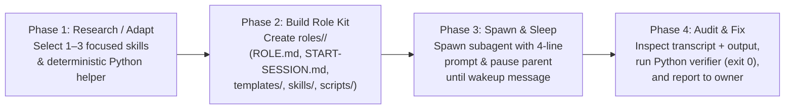

# Agent Handoff & Orchestrator Playbook (Kepler Dev Agency Lifecycle)

**Read this document first before taking any action.**  
This guide explains **what we are building**, **how the Agency repository differs from the Personal Portfolio**, and **the exact 4-Phase Orchestrator Workflow** used for every stage and role.

---

## 1. Critical Identity & Scope Rules

### A. Two Separate Repositories — Never Mix Identity
1. **Agency Portfolio Repo (THIS PROJECT):** `/home/kepler/Desktop/Kepler/Projects/portfolio`
   - **Brand:** **Kepler Dev** (`https://www.keplerdev.uk`) — an independent UK & GCC digital product and software engineering studio.
   - **Voice & Identity (CRITICAL):**
     - Speak **exclusively** as a standalone studio (`"we"`, `"our"`, `"Kepler Dev"`, `"our engineering team"`).
     - **Decoupled from Mahmoud Personally:** Never use `"I"` / `"my"`, never mention `"Mahmoud"` or `"Mahmoud Attia"`, never use `"Founder-led"` framing, never include personal portraits (`founder-*`), and never re-introduce `/mahmoud` or `@type: "Person"` JSON-LD.
     - **Sole Exception:** The email address `mahmouddattiaa7@gmail.com` may remain strictly as the contact/fallback email until replaced by a domain inbox.
   - **Project Catalog:** Features **all 13 projects** (6 Flagship Case Studies on `/work/[slug]` + 7 Studio Showcase/R&D builds on `/work`), all framed as **Kepler Dev studio or internal R&D deliveries**.
2. **Personal Portfolio Repo (SEPARATE PROJECT — READ-ONLY SOURCE FOR ASSETS/ROLE PATTERNS):** `/home/kepler/Desktop/Kepler/Projects/Personal Portfilio`
   - Do **not** modify files in the Personal Portfolio repo. We only reference its cleaned project media (`public/projects/`), technical project digests (`docs/context/`), and role-kit patterns (`roles/`).

---

## 2. How Our 4-Phase Orchestrator Workflow Works

Every role across Stages 0–5 follows the same **4-Phase Orchestrator Loop**:

### Phase 1 & 2: The 4-Part Session Kit (`roles/<role-name>/`)
Each role in `/home/kepler/Desktop/Kepler/Projects/portfolio/roles/<role-name>/` contains:
1. **`ROLE.md` (Compact Operating Manual — Under 60 lines):**
   - **Single Mission:** Exact deliverable file path.
   - **Hard Ground Rules:**
     - **No Directory Exploration (`ls`/`find`):** All input file paths are explicitly provided so the agent starts working on Turn 1.
     - **Studio Voice Only (`We / Kepler Dev`):** Zero `"I / my / Mahmoud"` or `"founder-led"` framing.
     - **Zero Banned AI Words & Structural Slogans:** Enforced by `roles/conversion-copywriter/scripts/copy_audit.py`.
     - **Progressive Skill Loading:** Load 1 skill per step (`Step 1 → Step 2 → Step 3 → Step 4`).
2. **`scripts/<verifier_script>.py` (Deterministic Python Verifier):**
   - Zero-dependency Python script that checks file existence, character counts, JSON-LD validity, WCAG contrast ratios, banned words, and personal-name decoupling in `<1s` (exiting `0` for `PASS` or `1` for `FAIL`).
3. **`templates/<deliverable>.template.md`:**
   - Structured output template with a mandatory self-audit evidence table.
4. **`START-SESSION.md`:**
   - Contains the exact 4-line prompt to launch the subagent.

### Phase 3: Spawn Subagent & Sleep (Zero Token Waste)
- When launching a subagent via `invoke_subagent`, pass the 4-line prompt from `START-SESSION.md` including: *"When complete, send a message back to the parent agent so it wakes up and reviews your deliverable."*
- Immediately end your turn (call no more tools) after `invoke_subagent` so the parent session sleeps until woken by the subagent's completion message.

### Phase 4: Parent Audit
- Inspect the deliverable and run the role's Python verifier script + `copy_audit.py` + `decoupling_audit.py` before presenting the stage checkpoint to the user.

---

## 3. Standing Rules (Never Violate)
1. **Zero Personal Attribution:** Never introduce `"Mahmoud"`, `"Founder"`, or solo freelancer framing into Kepler Dev's copy, code, schema, or assets.
2. **Zero AI Jargon:** Keep all documentation, plans, and copy plain, direct, and concrete.
3. **Git Safety:** Never push to `origin` unless explicitly instructed. Never commit `.env.local`.
