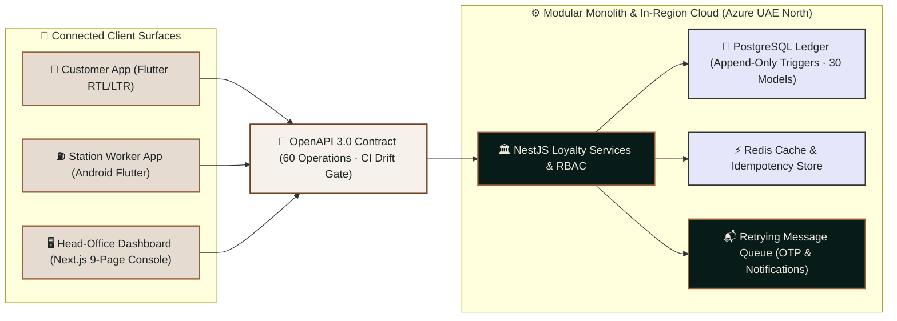
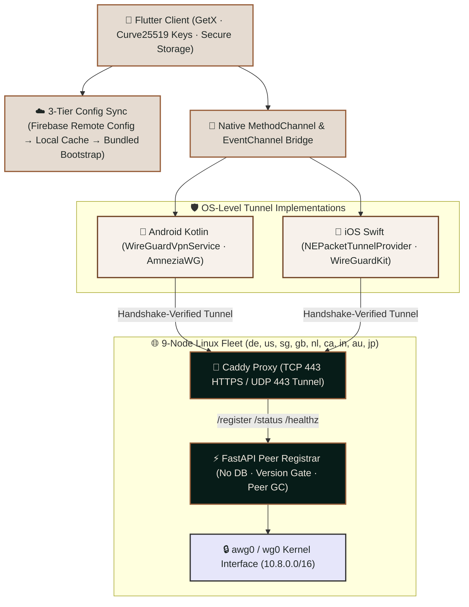
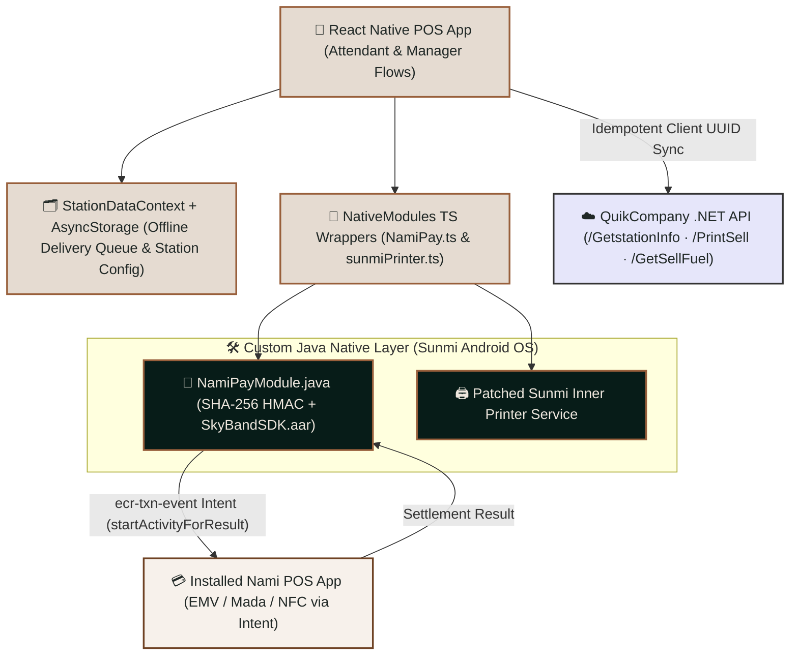
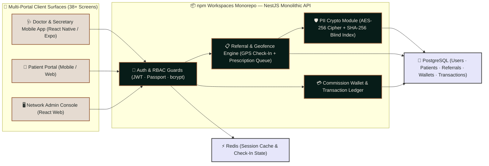
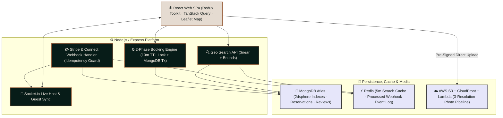
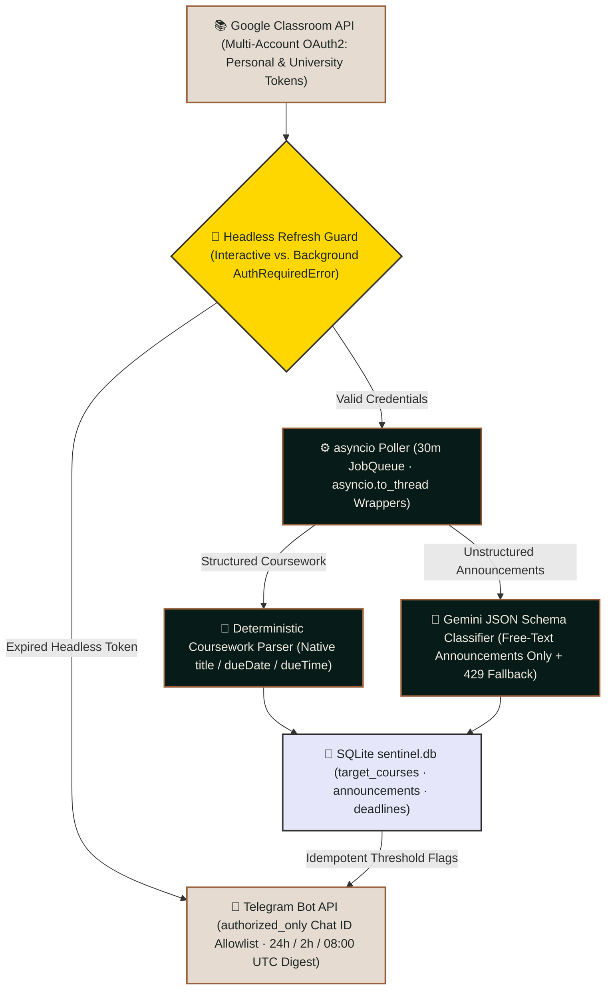

# Kepler Dev — Studio Flagship Case Studies & 13-Project Proof Spec (Stage 2 — Role 2 Output)

**Brand:** Kepler Dev (`https://www.keplerdev.uk`)  
**Voice:** Standalone UK & GCC Digital Product Studio (`we` / `our` / `Kepler Dev`)  
**Scope:** 6 Full Flagship Case Studies (`/work/[slug]`) + 7 Structured Studio Showcase & R&D Builds (`/work`)  
**Visual Asset Source:** Grounded in [stage-2-visual-asset-manifest.md](file:///home/kepler/Desktop/Kepler/Projects/portfolio/docs/stage-2-visual-asset-manifest.md)

---

## 1. Case Study 1: `Glitre Loyalty Platform` (`glitre-loyalty-platform`)

### A. Executive Snapshot
- **Slug & Classification:** `glitre-loyalty-platform` · `Client Work` · `Production (Backend & 9-Page Dashboard Live in Azure UAE North)`
- **Studio Role:** End-to-end Product Discovery, OpenAPI Contract Design, 3 Client Surfaces & Cloud Delivery
- **Core Stack:** NestJS, PostgreSQL, Redis, Flutter, Next.js, TypeScript, Azure UAE North
- **Primary Media:** `/projects/glitre-loyalty-platform/manager/overview.webp` (+ Illustrative Client & Ledger Frames)
- **Numbers Strip:** `4` Connected Products · `60` API Operations Under 1 Contract · `30` Data Models · `2` Languages (Arabic-First RTL & English) · `0` WCAG 2.1 AA Violations (`36` audited dashboard captures) · `31` Days from Kickoff to Production
- **1-Sentence Operational Outcome:** Replaced disconnected station transactions with an Arabic-first fuel loyalty ecosystem uniting drivers, forecourt workers, and head-office controllers under an append-only PostgreSQL points ledger.

### B. Operational Problem (Before vs. After)
- **Before:**
  - A driver filled up and left; nothing told the brand they had visited before or rewarded repeat stops.
  - Station staff had no structured way to record a loyalty purchase or validate a customer reward at the forecourt.
  - Head office could not see which customers returned across branches, track point liability, or isolate station exceptions.
  - Customer complaints arrived through scattered channels with no central owner, audit trail, or resolution state.
- **After:**
  - The driver presents a short-lived single-use code on their phone, and verified points land directly in an immutable statement-style balance.
  - Station staff scan the code on a dedicated Android device and record the purchase or redeem a voucher safely even on weak forecourt connections.
  - Head office monitors every station, worker, customer, transaction, and offer from a role-scoped Arabic and English dashboard.
  - Complaints enter a central queue with tracked ownership, server-returned audit references, and documented reversals.

### C. System Architecture Diagram (`Mermaid`)

### D. 3 Key Engineering Decisions (Consequence First, Mechanism Second)

#### Decision 1: Database-Enforced Append-Only Points Ledger
- **Business Consequence:** When a customer disputes a balance or a station worker enters an incorrect fuel total, finance and operations teams can audit every point from creation to redemption or reversal. No completed financial-value record can ever be silently edited or deleted.
- **Technical Mechanism:** PostgreSQL stores every point movement as an immutable ledger row (`Earn`, `Redeem`, `Reversal`, `Adjustment`) protected by database-level append-only constraints rather than application convention. Reversals retain the original transaction intact and write a compensating opposite entry linked to the approving administrator, timestamp, and reason code.
- **Verified Status / Outcome:** Live in production in Azure UAE North; finance and auditor roles inspect point liability directly through statement-grade transaction history without risking mutation of operational records.

#### Decision 2: Single-Use Signed QR Codes Paired with Idempotent Writes
- **Business Consequence:** A loyalty code cannot be screenshotted, shared across drivers, and claimed twice, while a station worker tapping confirm repeatedly on an unstable forecourt cellular connection never awards or deducts points more than once.
- **Technical Mechanism:** Customer QR codes carry short-lived cryptographic signatures verified and invalidated upon first consumption in Redis/PostgreSQL. Every value-moving write (`earn`, `redeem`, `reserve`, `reversal`) requires a client-generated idempotency key checked atomically before ledger mutation, while voucher redemptions reserve points prior to forecourt scan and commit atomically on confirmation.
- **Verified Status / Outcome:** Enforced across all value-moving endpoints in the NestJS modular monolith, protecting against double-awarding, replay attacks, and duplicate retry submissions.

#### Decision 3: Single OpenAPI Contract Governing Four Surfaces with CI Drift Detection
- **Business Consequence:** Adding a new station rule, complaint status, or bilingual field reaches the customer mobile app, worker device, and head-office console in lockstep, eliminating multi-week integration surprises and allowing parallel delivery in 31 days.
- **Technical Mechanism:** A single OpenAPI 3.0 specification (`60` operations across `30` data models) acts as the strict source of truth. Typed client SDKs and DTO validation schemas generate directly from the contract, and CI fails the build automatically whenever backend handlers and client expectations diverge.
- **Verified Status / Outcome:** Enabled parallel branch execution across all four surfaces, shipping the production backend and 9-page Arabic/English operations console in 31 days with `0` WCAG 2.1 AA accessibility violations across `36` audited dashboard captures.

### E. Honest Scope Boundaries & Visual Walkthrough
- **Honest Release Boundary:** The NestJS backend, PostgreSQL ledger, message queue, and 9-page bilingual Head-Office Operations Console are live in production in Azure UAE North, with customers currently registering and signing in via email verification codes. The Customer and Station Worker mobile applications are built cleanly against the OpenAPI contract and are staged for app-store distribution, production SMS OTP provisioning, and forecourt POS/pump hardware integration in the next phase.
- **Confidentiality & Illustrative Client Frames:** Per client confidentiality governance, raw screenshots of the customer and station-worker mobile applications are omitted from public distribution. Stage 3 renders two code-drawn illustrative frames in Kepler Dev styling—(1) a Customer App frame (`1,250` balance, `00:58` expiring code timer, RTL station finder) and (2) a Station Worker frame (`100.00` purchase confirmation, `+ 100` points settlement) plus a sequential ledger statement preview—clearly captioned as illustrative screens alongside the four owner-approved English manager console WebPs below.
- **Verified Asset Walkthrough:**
  1. **Primary Cover — Operations Overview:** `/projects/glitre-loyalty-platform/manager/overview.webp` (`1842x965`, `453.0 KB`) — **Alt Text:** `Glitre Loyalty Platform operations console overview showing station metrics and queue summary` — **Caption:** Operations console overview displaying live station, crew, complaint, and audit summary cards (English interface capture).
  2. **Stations Management:** `/projects/glitre-loyalty-platform/manager/stations.webp` (`1566x963`, `250.5 KB`) — **Alt Text:** `Glitre station directory management view with operating mode toggles and Arabic profile fields` — **Caption:** Station directory with manual operating overrides, service availability tags, and bilingual profile controls.
  3. **Complaints Resolution Queue:** `/projects/glitre-loyalty-platform/manager/complaints.webp` (`1574x966`, `152.0 KB`) — **Alt Text:** `Glitre customer complaint queue table paired with server audit reference detail panel` — **Caption:** CRM complaint queue and server-returned audit detail drawer backed by idempotent admin endpoints.
  4. **Role-Based Sign-In:** `/projects/glitre-loyalty-platform/manager/sign-in.webp` (`1309x773`, `502.4 KB` — flagged in Stage 4 optimization backlog for `<200 KB` WebP re-encoding) — **Alt Text:** `Glitre Loyalty Platform secure admin sign-in split screen with bilingual language switcher` — **Caption:** Secured administration sign-in surface with English and Arabic locale toggle.

---

## 2. Case Study 2: `HS VPN` (`hs-vpn`)

### A. Executive Snapshot
- **Slug & Classification:** `hs-vpn` · `Client Work` · `Production (Live on Google Play 10K+ Downloads; iOS TestFlight)`
- **Studio Role:** Architecture, Visual UI Design, Flutter Orchestration, Native Packet Tunnels & Multi-Node Server Infrastructure
- **Core Stack:** Flutter, Kotlin (`WireGuardVpnService.kt`), Swift (`NEPacketTunnelProvider` + `WireGuardKit`), AmneziaWG / WireGuard, Python FastAPI, Firebase Remote Config
- **Primary Media:** `/projects/hs-vpn/hero.png` + Video Preview `/projects/hs-vpn/preview.mp4`
- **Numbers Strip:** `10K+` Google Play Downloads · `9` Global Server Regions (`de`, `us`, `sg`, `gb`, `nl`, `ca`, `in`, `au`, `jp`) · `3`-Tier Catalog Fallback · `2` Native OS Tunnel Bridges (`Android` & `iOS`) · `0` Backend Database Dependencies
- **1-Sentence Operational Outcome:** Delivered reliable VPN connectivity inside DPI-heavy networks where standard WireGuard handshakes are fingerprinted and blocked, reaching 10K+ Google Play downloads across a 9-node international fleet.

### B. Operational Problem (Before vs. After)
- **Before:**
  - Standard WireGuard wrappers exhibit a predictable handshake packet signature that ISPs in censorship-heavy regions fingerprint and drop at the network edge.
  - Consumers experienced apps showing "Connected" UI states before an actual tunnel handshake completed, causing unencrypted traffic leaks or silent blackholing.
  - Rotating blocked server IPs, disabling failing ad providers, or retiring broken app builds required waiting days for mobile store review cycles.
- **After:**
  - Android clients route traffic over an AmneziaWG-capable transport on `awg0` nodes behind Caddy TCP/UDP 443 endpoints, bypassing ISP deep packet inspection.
  - Connection state waits strictly for native OS handshake confirmation before updating UI status, logging session telemetry, or triggering post-connect monetization.
  - Operators adjust server catalogs, transport preferences, version floors, and granular ad kill switches instantly via Firebase Remote Config without shipping a new binary.

### C. System Architecture Diagram (`Mermaid`)

### D. 3 Key Engineering Decisions (Consequence First, Mechanism Second)

#### Decision 1: AmneziaWG Obfuscated Transport & Handshake-Confirmed Session Semantics
- **Business Consequence:** Users in DPI-heavy markets stay connected instead of stalling on blocked WireGuard ports, and the app never misleads users into thinking their traffic is protected when a handshake fails.
- **Technical Mechanism:** Both the Kotlin `WireGuardVpnService.kt` layer and the 9-node Linux fleet migrated from plain WireGuard (`wg0`) to AmneziaWG (`awg0`) obfuscation controlled by the `enforce_amnezia_only` Remote Config flag. `ConnectionOrchestrator` orders candidate profiles, registers the client's Curve25519 public key (stored in `flutter_secure_storage`) with the target node, starts the OS tunnel, and blocks session-active callbacks, analytics events, and post-connect interstitials until a real packet handshake signal returns over `EventChannel`.
- **Verified Status / Outcome:** Live in production on Google Play (`com.hsvpn.vpn` v2.1.2+23) with `10K+` downloads and sustained traffic across DPI-restricted networks (including ~1,500 Turkmenistan users recorded in Firebase).

#### Decision 2: Stateless Python FastAPI Peer Registrar Over Database-Backed Auth
- **Business Consequence:** Deploying a new regional exit node takes minutes with zero database synchronization lag, zero user account PII stored on servers, and immediate enforcement of outdated-client lockouts.
- **Technical Mechanism:** Each node runs `backend/peer_registrar.py` (FastAPI + `uvicorn` bound to `127.0.0.1:5000` behind Caddy TCP 443) with no SQL or NoSQL database—the live `awg0`/`wg0` kernel interface is the single source of truth. The registrar authenticates requests via shared `x-api-key`, assigns `/32` IPs across `10.8.0.0/16` keyed purely by public key, enforces a server-side Android version gate, exposes `/healthz` and `/diag`, and garbage-collects inactive peers automatically.
- **Verified Status / Outcome:** Powers all 9 global exit nodes in production (`de`, `us`, `sg`, `gb`, `nl`, `ca`, `in`, `au`, `jp`) with zero user-account storage footprint.

#### Decision 3: Three-Tier Config Resolution & Remote Control Plane Kill Switches
- **Business Consequence:** Even if ISP throttling blocks Firebase endpoints or an ad mediation SDK triggers a crash loop after release, existing mobile installs keep connecting and operations teams can disable individual ad networks or force-upgrade clients remotely.
- **Technical Mechanism:** `ConfigSyncService` resolves server catalogs through a deterministic three-tier fallback (`Firebase Remote Config` → `last-known-good local cache` → `bundled bootstrap catalog`). Remote Config keys govern `vpn_server_list`, `vpn_config_generation`, `minimum_required_vpn_config_generation`, `minimum_supported_android_version_code`, and granular ad kill switches (`ads_enabled`, `admob_interstitial_enabled`, `unity_interstitial_enabled`, `native_ads_enabled`).
- **Verified Status / Outcome:** Eliminated emergency hotfix cycles for catalog rotations and ad-network throttling across live Android releases.

### E. Honest Scope Boundaries & Screen-by-Screen Visual Walkthrough
- **Honest Release Boundary:** Android (`com.hsvpn.vpn`) is the primary Google Play production path with full AmneziaWG anti-DPI support. The iOS client (`com.hsvpn.hsvpn`) implements a native Swift `NEPacketTunnelProvider` + `WireGuardKit` extension (`group.84LPYPG2J8.hsvpn`) validated via TestFlight, but remains plain WireGuard without AmneziaWG and awaits macOS/Xcode archive validation before App Store release. Future protocol entries in the Dart data model (`REALITY`, `Hysteria2`, `MASQUE`) are control-plane scaffolding and are not active production transports.
- **Verified Asset Walkthrough (`/projects/hs-vpn/` Production Android + `/projects/HS-VPN/` Historical iOS TestFlight):**
  - **Video Walkthrough:** `/projects/hs-vpn/preview.mp4` (`10653.5 KB`) — Full Android connection, server switch, and telemetry flow.
  1. **Connected Tunnel Dashboard:** `/projects/hs-vpn/hero.png` (`706x1600`, `233.0 KB`) — **Alt Text:** `HS VPN Android app connected screen showing Nuremberg tunnel status and live Mbps throughput` — **Caption:** Connected WireGuard tunnel view displaying verified handshake state, virtual IP, and live upload/download telemetry.
  2. **Global Server Selection:** `/projects/hs-vpn/server_selection.png` (`706x1600`, `188.5 KB`) — **Alt Text:** `HS VPN server selection list showing multi-node edge locations and latency indicators` — **Caption:** Multi-node Linux server catalog backed by 3-tier remote configuration fallback.
  3. **Live Session Telemetry:** `/projects/hs-vpn/statistics_page.png` (`706x1600`, `129.2 KB`) — **Alt Text:** `HS VPN session statistics screen tracking encrypted packet volume and connection duration` — **Caption:** Real-time session telemetry tracking packet transfer, protocol status, and uptime.
  4. **Infrastructure Architecture View:** `/projects/hs-vpn/premium_infrastructure.png` (`706x1600`, `245.7 KB`) — **Alt Text:** `HS VPN infrastructure details view highlighting AmneziaWG obfuscation and routing nodes` — **Caption:** Anti-DPI routing configuration surface exposing protocol fallback and multi-node topology.
  5. **Privacy Setup & Diagnostics:** `/projects/hs-vpn/privacy_setup.png` (`702x1600`, `234.0 KB`) — **Alt Text:** `HS VPN privacy setup screen showing split tunneling and DNS protection controls` — **Caption:** Local tunnel permissions and DNS leak protection setup inside the Flutter client.
  6. **Secondary iOS TestFlight — Connected State:** `/projects/HS-VPN/connected-ios.jpg` (`1284x2778`, `246.3 KB`) — **Alt Text:** `HS VPN iOS TestFlight capture showing active NEPacketTunnelProvider connection state` — **Caption:** Historical iOS TestFlight build validating native Swift `NEPacketTunnelProvider` execution.
  7. **Secondary iOS TestFlight — Server List:** `/projects/HS-VPN/servers-ios.jpg` (`1284x2778`, `312.7 KB`) — **Alt Text:** `HS VPN iOS TestFlight server directory screen listing regional tunnel endpoints` — **Caption:** Historical iOS TestFlight endpoint selector synced with the FastAPI peer registrar.
  8. **Secondary iOS TestFlight — Telemetry:** `/projects/HS-VPN/statistics-ios.jpg` (`1284x2778`, `225.2 KB`) — **Alt Text:** `HS VPN iOS TestFlight statistics capture displaying encrypted tunnel traffic metrics` — **Caption:** Historical iOS TestFlight connection statistics screen.

---

## 3. Case Study 3: `QuickChargingPOS` (`quickcharging-pos`)

### A. Executive Snapshot
- **Slug & Classification:** `quickcharging-pos` · `Client Work` · `Production (Deployed on Sunmi Industrial Android POS Hardware)`
- **Studio Role:** Industrial Mobile & Hardware Integration Engineering
- **Core Stack:** React Native `0.83.1`, TypeScript, Java (`NamiPayModule.java`), SkyBand / Mada SDK (`SkyBandSDK-release.aar`), Sunmi Thermal Printer SDK, `AsyncStorage`, QuikCompany `.NET` API
- **Primary Media:** `/projects/quickcharging/home_station_ready/screen.png` + Video Preview `/projects/quickcharging/preview.mp4`
- **Numbers Strip:** `0s` Cloud Payment Gateway Overhead (Local Android Intent) · `SHA-256` HMAC-Signed EMV/Mada Payloads · `50`-Record Offline Fuel Delivery Cache · `100%` Native Sunmi Thermal Printing
- **1-Sentence Operational Outcome:** Deployed an industrial React Native POS application to Sunmi forecourt terminals across Saudi Arabia, eliminating 3–5 second cloud payment delays through local HMAC-signed Android Intents and offline-resilient delivery logging.

### B. Operational Problem (Before vs. After)
- **Before:**
  - Standard cloud payment gateways added 3–5 seconds of round-trip latency per vehicle at busy Saudi fuel and EV charging bays, backing up forecourt queues.
  - Cross-platform React Native apps lacked direct access to SkyBand's signed EMV/Mada payment protocol and proprietary Sunmi ESC/POS thermal printer bindings.
  - Station managers could not log fuel truck deliveries or reconcile nozzle/tank levels when forecourt cellular links dropped.
- **After:**
  - Attendants trigger instant local App-to-App Android Intents to the installed Nami POS terminal app, removing cloud payment gateway latency from the pump workflow.
  - Completed payments print localized, double-width thermal receipts automatically on the Sunmi built-in printer while syncing asynchronously with client-side UUID idempotency.
  - Station managers record fuel deliveries (`volumeBefore`, `volumeAdded`, `totalCost`) into a local `AsyncStorage` queue that persists until connectivity returns.

### C. System Architecture Diagram (`Mermaid`)

### D. 3 Key Engineering Decisions (Consequence First, Mechanism Second)

#### Decision 1: Signed App-to-App Android Intent Bridge Over Cloud Payment APIs
- **Business Consequence:** Fuel and EV attendants clear vehicles faster at the pump without waiting 3–5 seconds per transaction for external cloud payment polling, while card terminals reject tampered payment requests.
- **Technical Mechanism:** Our engineers authored `NamiPayModule.java` around `SkyBandSDK-release.aar`. Instead of calling a remote payment API from JavaScript, the module constructs an `ecr-txn-event` Android Intent, packs the transaction payload into a byte array, computes a **SHA-256 HMAC signature** from the terminal ID and ECR reference, and invokes the local Nami POS app via `startActivityForResult`.
- **Verified Status / Outcome:** Deployed on physical Sunmi Android POS hardware, authorizing Mada/EMV/NFC transactions locally at hardware speed.

#### Decision 2: Custom-Patched Sunmi Thermal Printer Wrapper with Emulator Fallback
- **Business Consequence:** Customers receive clean, bilingual-ready itemized thermal receipts immediately after payment authorization, while engineering teams can still test end-to-end checkout flows on standard non-POS emulators.
- **Technical Mechanism:** Integrated `react-native-sunmi-inner-printer` with `patch-package` compatibility fixes for React Native `0.83.1`, wrapped in `sunmiPrinter.ts`. The wrapper handles ESC/POS column alignment and double-width formatting for totals on physical hardware, degrading cleanly to structured console telemetry when Sunmi printer services are absent.
- **Verified Status / Outcome:** Prints station receipts and fuel delivery summaries reliably on Sunmi terminals in production.

#### Decision 3: Local Station Binding & Offline-First Fuel Delivery Queue
- **Business Consequence:** Field technicians deploy a single APK across multiple fuel stations without rebuilding per site, and station managers never lose delivery reconciliation logs during internet outages.
- **Technical Mechanism:** Technician provisioning writes `@qserv_technician_config` (station ID and dynamic `baseUrl`) into `AsyncStorage` to bind each terminal permanently to its physical station hierarchy (`Station → Dispensers → Nozzles → Tanks`). Separately, `deliveryManager.ts` caches up to 50 `FuelDeliveryRecord` entries locally with `syncStatus` flags and reconciles against `/Transaction/PrintSell` using client-generated UUIDs for idempotency.
- **Verified Status / Outcome:** Eliminated per-site APK builds and protected station delivery accounting against unstable forecourt networks.

### E. Honest Scope Boundaries & Screen-by-Screen Visual Walkthrough
- **Honest Release Boundary:** Built and deployed strictly for Android-based Sunmi POS hardware with the local Nami POS app installed; the iOS project directory carries no native payment or thermal printer SDKs. Prior to broader multi-tenant rollout beyond initial stations, hardcoded Basic Auth headers in `quickApi.ts` and test terminal constants (`TEST_CASH_REGISTER_NO`, `TEST_TERMINAL_ID`) in `NamiPayModule.java` are scheduled to move into dynamic per-terminal provisioning, alongside React error-boundary surfacing for API retries.
- **Verified Asset Walkthrough (`/projects/quickcharging/`):**
  - **Video Walkthrough:** `/projects/quickcharging/preview.mp4` (`2857.7 KB`) — Sunmi POS charging setup, Mada authorization, and receipt printout flow.
  1. **Station Ready Terminal:** `/projects/quickcharging/home_station_ready/screen.png` (`706x1600`, `211.0 KB`) — **Alt Text:** `QuickChargingPOS Sunmi terminal ready screen with start charging button and station ID` — **Caption:** Forecourt terminal idle state displaying active terminal ID, connectivity status, and QR scan entry.
  2. **Charging Configuration:** `/projects/quickcharging/charging_configuration/screen.png` (`662x1600`, `194.2 KB`) — **Alt Text:** `QuickChargingPOS charging configuration screen for selecting kWh energy volume and tariff` — **Caption:** Attendant workflow for setting charging volume, pump bay, and billing parameters.
  3. **Mada Payment Processing:** `/projects/quickcharging/payment_processing/screen.png` (`706x1600`, `266.4 KB`) — **Alt Text:** `QuickChargingPOS Mada card payment processing screen via Java NamiPayModule bridge` — **Caption:** Active SkyBand / Mada card authorization bridged through the custom Java `NamiPayModule` Intent handler.
  4. **Receipt & Settlement Success:** `/projects/quickcharging/payment_success/screen.png` (`673x1600`, `198.7 KB`) — **Alt Text:** `QuickChargingPOS payment confirmation screen with thermal receipt print status` — **Caption:** Verified HMAC-SHA256 settlement confirmation triggering automatic Sunmi thermal receipt printing.
  5. **Offline Transaction Ledger:** `/projects/quickcharging/transaction_history/screen.png` (`706x1600`, `155.3 KB`) — **Alt Text:** `QuickChargingPOS offline-capable transaction history list showing synced fuel charges` — **Caption:** Local terminal ledger preserving queued fuel deliveries during network drops until cloud reconciliation.

---

## 4. Case Study 4: `MedConnect Egypt` (`medconnect-egypt`)

### A. Executive Snapshot
- **Slug & Classification:** `medconnect-egypt` · `Studio Product Build` · `Full Multi-Surface MVP (38+ Screens)`
- **Studio Role:** Full-Stack Systems Architecture, Security Schema Design, Dual Mobile & Admin Web Delivery
- **Core Stack:** NestJS (Monolithic API in npm workspaces monorepo), React Native (Expo), React Web, PostgreSQL (TypeORM / Prisma), Redis, AES-256 + SHA-256 Blind Indexing
- **Primary Media:** `/projects/medconnect/doctor_dashboard/screen.png` + Video Preview `/projects/medconnect/preview.mp4`
- **Numbers Strip:** `38+` Screens Across 3 Portals · `256`-Bit AES Patient PII Encryption · `O(1)` Deterministic Blind-Index Lookup · `3` Core Actor Roles (Doctor, Clinic Secretary/Patient, Admin)
- **1-Sentence Operational Outcome:** United referring physicians, specialist clinics, and patients in a closed-loop Egyptian healthcare referral MVP protected by encrypted National ID blind indexing and GPS geofenced clinic check-ins.

### B. Operational Problem (Before vs. After)
- **Before:**
  - Primary physicians referred patients via handwritten notes or WhatsApp messages, losing clinical context and forfeiting earned referral commissions when visits went untracked.
  - Clinics had no reliable way to verify whether a referred patient physically arrived at the specialist office or whether staff forged check-in claims remotely.
  - Encrypting Egyptian National IDs for medical privacy made standard SQL `WHERE` deduplication impossible without decrypting entire tables.
- **After:**
  - Doctors create digital referrals in seconds—optionally snapping a handwritten prescription for queued transcription—while patients receive an exclusive referral discount code tied to in-app check-in.
  - Clinic secretaries execute a GPS geofenced double-handshake check-in only when the patient is physically present at the clinic, automatically crediting the referring doctor's wallet ledger.
  - Patient records store AES-256 encrypted National IDs alongside a deterministic SHA-256 blind-index hash for fast, compliant duplicate checks.

### C. System Architecture Diagram (`Mermaid`)

### D. 3 Key Engineering Decisions (Consequence First, Mechanism Second)

#### Decision 1: AES-256 Encryption Paired with Deterministic SHA-256 Blind Indexing
- **Business Consequence:** Patient National IDs remain unreadable if database backups leak, yet intake staff can still check instantly whether a patient already exists in the network without creating duplicate medical histories.
- **Technical Mechanism:** The `Patient` entity stores two separate columns: `nationalIdEncrypted` (AES-256 encrypted byte array for authorized retrieval) and `nationalIdHash` (a deterministic SHA-256 hash indexed with a unique constraint). Incoming intake queries hash the candidate ID and execute an `O(1)` indexed SQL lookup without ever exposing plaintext PII in query logs.
- **Verified Status / Outcome:** Implemented in the core PostgreSQL schema and verified across patient registration and lookup endpoints (scheduled for KMS key rotation before clinical production launch).

#### Decision 2: GPS Geofenced Double-Handshake & Patient Discount Incentive Design
- **Business Consequence:** Clinics cannot fabricate remote check-ins to manipulate referral payouts, and specialists cannot easily bypass the platform off-book because patients lose their exclusive referral discount if they skip app check-in.
- **Technical Mechanism:** When a patient arrives at the specialist clinic, the clinic secretary initiates check-in through `/referrals/:id/status`, which validates the device's physical GPS coordinates against the specialist clinic's registered geofence before transitioning referral state and emitting a ledger credit into the referring doctor's `Wallet`.
- **Verified Status / Outcome:** Built into the NestJS referral state machine, closing both commission fraud and referral leakage loops within one workflow.

#### Decision 3: Monolithic NestJS API in an npm-Workspaces Monorepo + Batch Wallet Ledger
- **Business Consequence:** A lean engineering team can ship and audit authentication, referrals, and commission accounting in a single deployable unit without distributed-systems overhead, while avoiding per-referral bank transfer fees.
- **Technical Mechanism:** Rather than splitting into premature microservices, all domain modules (`auth`, `referrals`, `wallet`, `database`) reside inside one TypeScript NestJS API alongside `apps/mobile` in an npm workspaces monorepo. Commissions accumulate inside a relational `Wallet` + `Transaction` ledger for weekly or monthly batch settlements rather than per-visit gateway transfers.
- **Verified Status / Outcome:** Completed as a full multi-surface MVP (`38+` screens) with Jest/Supertest backend coverage and photo-capture prescription upload preserving doctors' existing handwriting habits.

### E. Honest Scope Boundaries & Screen-by-Screen Visual Walkthrough
- **Honest Release Boundary:** Built as a comprehensive multi-surface MVP (`monorepo with a NestJS monolithic API and React Native / React web clients`, explicitly not microservices). Several downstream integrations—AWS Textract automated OCR transcription queue, third-party diagnostic lab APIs, Paymob/Stripe live settlement disbursement, FCM push delivery, shared DTO population in `packages/shared`, and KMS-backed encryption key rotation replacing the dev placeholder secret—are scoped as Phase 2 hardening items prior to commercial hospital rollout.
- **Verified Asset Walkthrough (`/projects/medconnect/`):**
  - **Video Walkthrough:** `/projects/medconnect/preview.mp4` (`6422.7 KB`) — End-to-end doctor referral creation, patient record, and admin oversight walkthrough.
  1. **Doctor Referral Dashboard:** `/projects/medconnect/doctor_dashboard/screen.png` (`1600x1566`, `312.7 KB`) — **Alt Text:** `MedConnect Egypt doctor referral dashboard showing active patient cases and specialist metrics` — **Caption:** Clinician command center tracking outgoing referrals, pending responses, and Cairo specialist capacity.
  2. **Encrypted Patient Record:** `/projects/medconnect/patient_medical_record/screen.png` (`1252x1600`, `389.5 KB`) — **Alt Text:** `MedConnect Egypt patient medical record view with diagnostic history and visit logs` — **Caption:** Patient record view backed by AES-256 encrypted National IDs and SHA-256 blind-index lookup.
  3. **Geofenced Referral Creation:** `/projects/medconnect/create_referral_form/screen.png` (`1600x1485`, `307.4 KB`) — **Alt Text:** `MedConnect Egypt referral creation form linking clinic department and specialist transfer` — **Caption:** Structured referral workflow tied to GPS geofence-verified clinic check-ins to prevent commission fraud.
  4. **Patient Portal Home:** `/projects/medconnect/patient_portal_home/screen.png` (`1600x1280`, `383.2 KB`) — **Alt Text:** `MedConnect Egypt patient portal home showing upcoming clinic visits and referral status` — **Caption:** Patient-facing portal displaying active specialist appointments and verified clinic check-in status.
  5. **Network Admin Console:** `/projects/medconnect/admin_dashboard/screen.png` (`1459x1600`, `285.4 KB`) — **Alt Text:** `MedConnect Egypt network admin dashboard overseeing clinic verification and referral audits` — **Caption:** Administrative oversight view auditing clinic onboarding, referral commissions, and compliance logs.

---

## 5. Case Study 5: `StayEase` (`stayease`)

### A. Executive Snapshot
- **Slug & Classification:** `stayease` · `Studio Product Build` · `Built Full-Stack Web Platform (40+ Screen Assets)`
- **Studio Role:** Full-Stack Engineering, Transaction Concurrency Architecture & Stripe Payment Integration
- **Core Stack:** React (SPA), Redux Toolkit, TanStack Query, Leaflet.js, Node.js / Express, MongoDB (`TTL Locks` + `2dsphere` Geospatial), Redis, Stripe & Stripe Connect, AWS S3 + Lambda
- **Primary Media:** `/projects/StayEase/stayease_landing_page/screen.png` + Video Preview `/projects/StayEase/preview.mp4`
- **Numbers Strip:** `<200ms` Geospatial City Search (Redis + `2dsphere`) · `10`-Minute Transactional Room Hold (TTL Lock) · `3`-Step Maximum Checkout Flow · `24h` Post-Check-In Stripe Connect Settlement
- **1-Sentence Operational Outcome:** Engineered a clarity-first hotel discovery and booking web platform that eliminates concurrent last-room double-bookings and duplicate payment settlements through TTL reservation holds and Redis-deduplicated Stripe webhooks.

### B. Operational Problem (Before vs. After)
- **Before:**
  - Competing hospitality portals buried travelers in dozens of cluttered filters, hidden fees revealed only at final checkout, and stale cached room counts that caused failed bookings after card entry.
  - Concurrent guests attempting to book the last available room during checkout created race conditions and double-booking disputes for property hosts.
  - Retried payment webhooks risked triggering duplicate booking confirmations or double-crediting host payouts.
- **After:**
  - Guests search across map-bounded geospatial inventory with transparent upfront pricing (`nightly rate × nights + cleaning fee + platform fee`) and a maximum three-step checkout.
  - Selecting a room initiates an uncached real-time availability check and places a 10-minute MongoDB TTL lock inside a transaction while Stripe Elements collects payment.
  - Stripe webhook handlers deduplicate every event ID in Redis before confirming bookings, emitting real-time Socket.io host dashboard updates, or scheduling automated Stripe Connect payouts 24 hours after check-in.

### C. System Architecture Diagram (`Mermaid`)

### D. 3 Key Engineering Decisions (Consequence First, Mechanism Second)

#### Decision 1: Two-Phase Booking Flow with 10-Minute MongoDB TTL Locks
- **Business Consequence:** Two travelers clicking "Reserve" on the final available room at the exact same second never end up with overlapping confirmed reservations, preventing costly host cancellations and guest refunds.
- **Technical Mechanism:** While search results cache for 5 minutes in Redis, hotel detail pages query room availability uncached in real time. Before payment, Phase 1 opens a MongoDB transaction and inserts a temporary reservation hold with a 10-minute TTL; Phase 2 confirms the Stripe `PaymentIntent` via Stripe Elements (keeping raw card data off application servers) and atomically upgrades the hold to a confirmed booking, while an expiration job releases abandoned holds.
- **Verified Status / Outcome:** Eliminates concurrent double-booking race conditions across multi-tab and high-concurrency checkout attempts.

#### Decision 2: Idempotent Stripe Webhook Settlement via Redis Processed-Events Log
- **Business Consequence:** Network retries or duplicate webhook deliveries from Stripe never confirm a booking twice, send duplicate SendGrid confirmation emails, or disburse double payouts to property hosts.
- **Technical Mechanism:** Every incoming Stripe and Stripe Connect webhook checks its unique Stripe `event.id` against an atomic processed-events key in Redis before mutating booking status or triggering escrow settlement (`24 hours` post-check-in minus platform fee). Real-time confirmation pushes simultaneously over Socket.io to both the guest confirmation view and the host's live dashboard.
- **Verified Status / Outcome:** Guarantees single-execution semantics across payment success, failure, refund, and host payout webhooks.

#### Decision 3: Geospatial Indexing + Serverless Lambda Multi-Resolution Image Pipeline
- **Business Consequence:** Map panning across dense city listings responds in under 200ms without loading multi-megabyte host photos onto mobile browsers, keeping bounce rates low while preserving crisp full-screen property galleries.
- **Technical Mechanism:** MongoDB Atlas `2dsphere` geospatial `$near` queries pair with a 5-minute parameter-keyed Redis cache for list and Leaflet cluster rendering. Host image uploads stream directly to S3 via pre-signed URLs, triggering an AWS Lambda pipeline that outputs compressed thumbnail, medium, and full-resolution variants served through CloudFront CDN.
- **Verified Status / Outcome:** Achieved `<200ms` cached/indexed search responses and automated zero-touch image optimization across host listings.

### E. Honest Scope Boundaries & Screen-by-Screen Visual Walkthrough
- **Honest Release Boundary & Framing Rule:** StayEase is a full-stack **React web application** (SPA + Node/Express backend), not a native mobile app. All six on-disk captures in `/projects/StayEase/` are tall vertical mobile-viewport scroll strips (`239x1600` to `583x1600`); Stage 3/4 UI components frame them inside scrollable mobile viewport mockups or paired portrait cards rather than cropping them into wide 16:9 desktop frames.
- **Verified Asset Walkthrough (`/projects/StayEase/`):**
  - **Video Walkthrough:** `/projects/StayEase/preview.mp4` (`4083.7 KB`) — Search, property inspection, checkout hold, and host dashboard walkthrough.
  - **Primary Cover:** `/projects/StayEase/stayease_landing_page/screen.png` (`267x1600`, `350.7 KB`) — **Alt Text:** `StayEase hospitality booking landing view showing destination search and curated properties` — **Caption:** Curated property discovery landing screen with destination, date, and guest capacity filters.
  1. **Property Search Results:** `/projects/StayEase/stayease_search_results/screen.png` (`310x1600`, `473.1 KB`) — **Alt Text:** `StayEase search results list displaying nightly rates, amenities, and availability filters` — **Caption:** Filtered inventory search displaying real-time room availability backed by MongoDB TTL locks.
  2. **Property Detail & Lock Initiation:** `/projects/StayEase/stayease_hotel_detail/screen.png` (`273x1600`, `309.1 KB`) — **Alt Text:** `StayEase property detail view presenting room breakdown, pricing, and reservation action` — **Caption:** Listing detail page initiating transactional TTL holds before Stripe checkout begins.
  3. **Idempotent Booking Confirmation:** `/projects/StayEase/stayease_confirmation/screen.png` (`382x1600`, `295.5 KB`) — **Alt Text:** `StayEase reservation confirmation receipt verifying Stripe payment settlement and room lock` — **Caption:** Confirmed reservation state finalized via Redis-deduplicated Stripe payment webhooks.
  4. **Host Inventory Dashboard:** `/projects/StayEase/stayease_host_dashboard/screen.png` (`239x1600`, `137.1 KB`) — **Alt Text:** `StayEase host dashboard displaying property occupancy, payout totals, and active bookings` — **Caption:** Host operations console for managing room inventory, nightly rates, and payout logs.
  5. **Guest & Host Inbox:** `/projects/StayEase/stayease_inbox/screen.png` (`583x1600`, `246.5 KB`) — **Alt Text:** `StayEase messaging inbox showing structured guest check-in threads and host replies` — **Caption:** Real-time guest-to-host communication thread linked directly to booking references.

---

## 6. Case Study 6: `Classroom Sentinel` (`classroom-sentinel`)

### A. Executive Snapshot
- **Slug & Classification:** `classroom-sentinel` · `Studio Automation System` · `Production (Self-Hosted 24/7 Daemon)`
- **Studio Role:** Python `asyncio` Systems Architecture, Schema-Constrained AI Parsing & Delivery Automation
- **Core Stack:** Python (`asyncio`), `python-telegram-bot` (`JobQueue` + `ConversationHandler`), `aiosqlite` (SQLite), Google Classroom API + OAuth2, Google Gemini (`google-genai` JSON Schema), `systemd`
- **Primary Media:** `/projects/Sintenel/logo.png` + Video Preview `/projects/Sintenel/preview.mp4`
- **Numbers Strip:** `24/7` Headless Polling Daemon · `30m` Sync & Reminder Interval (`1800s`) · `2` Reminder Windows (`24h` & `2h`) · `7` Read-Only OAuth Scopes · `0` Duplicate Reminder Alerts
- **1-Sentence Operational Outcome:** Automated 24/7 academic monitoring across multiple Google identities by turning unstructured Arabic and English Classroom feeds into schema-validated SQLite deadlines and zero-duplicate Telegram alerts.

### B. Operational Problem (Before vs. After)
- **Before:**
  - Important announcements, quiz dates, and assignment deadlines were scattered across multiple Google Classroom identities (`Personal` and `University`), buried inside free-text instructor posts.
  - Standard headless OAuth automation deadlocked or crashed unattended when refresh tokens expired and an SDK attempted to launch a local browser prompt.
  - Naive polling scripts repeatedly re-notified users every cycle or risked trusting an LLM to guess structured API dates.
- **After:**
  - A headless `asyncio` daemon polls all tracked courses across multiple OAuth token files every 30 minutes (`1800s`), unifying them under one Telegram command center (`/track`, `/due`, `/digest`, `/stream`, `/search`, `/health`).
  - Native Classroom coursework due dates parse deterministically from structured API fields, while free-text announcements route to Gemini under strict JSON Schema and enum constraints.
  - SQLite (`sentinel.db`) tracks announcement deduplication and boolean alert flags (`alert_24h_sent`, `alert_2h_sent`, `completed`) so each urgent window fires once and can be marked done inline.

### C. System Architecture Diagram (`Mermaid`)

### D. 3 Key Engineering Decisions (Consequence First, Mechanism Second)

#### Decision 1: Surgical AI Boundary — Native Parsing for Structured APIs, Schema-Constrained Gemini for Free Text
- **Business Consequence:** Deadlines attached to official assignments never suffer from LLM hallucination or date drift, while informal deadlines buried in instructor announcements are still captured accurately with zero extra API spend on already-structured data.
- **Technical Mechanism:** `process_announcements()` separates Classroom payloads by source type. Structured coursework and materials parse deterministically from Google API `dueDate` and `dueTime` fields. Only unstructured announcement text goes to Google Gemini (`google-genai`) with strict JSON Schema output, urgency enums, and automatic `429` model fallback.
- **Verified Status / Outcome:** Runs reliably across mixed Arabic and English course streams while minimizing token cost and eliminating date-parsing hallucinations on coursework items.

#### Decision 2: Headless-Safe Multi-Account OAuth Context Guard
- **Business Consequence:** An expired Google OAuth token in an unattended background service never freezes the daemon waiting for a phantom desktop browser login; instead, the operator receives an immediate actionable Telegram alert while the bot keeps running.
- **Technical Mechanism:** `get_classroom_service_sync()` accepts explicit execution context flags distinguishing interactive setup from background polling. When token refresh fails in background mode across either `token_personal.json` or `token_uni.json`, it raises `AuthRequiredError` cleanly, notifying the allowlisted `TELEGRAM_CHAT_ID` operator without blocking the event loop. Tracked courses persist their `account_type` in `target_courses`, keeping multi-identity routing invisible in daily `/due` and `/digest` commands.
- **Verified Status / Outcome:** Sustained unattended 24/7 `systemd` uptime across multiple Google Classroom identities.

#### Decision 3: Idempotent Polling & DB-Backed Reminder Threshold Flags
- **Business Consequence:** Overlapping 30-minute sync windows never spam the user with repeat alerts for the same assignment, and completing a task via an inline Telegram button silences future 24-hour and 2-hour reminders immediately.
- **Technical Mechanism:** Incoming announcements check `announcements.id` existence in `sentinel.db` before insert. Each extracted task stores `alert_24h_sent`, `alert_2h_sent`, and `completed` flags alongside `due_date`; scheduled reminder jobs evaluate both threshold windows and prior-send booleans before dispatching Telegram pushes, while callback handlers (`done_<deadline_id>`) update completion state atomically.
- **Verified Status / Outcome:** Zero duplicate alerts across overlapping polling runs, paired with daily `08:00 UTC` cross-course briefings and `/health` CPU/RAM/DB-size diagnostics.

### E. Honest Scope Boundaries & Live Daemon Pipeline Walkthrough
- **Honest Release Boundary:** Designed intentionally as a single-owner, lightweight `systemd` daemon secured via a strict `TELEGRAM_CHAT_ID` allowlist (`authorized_only` decorator) rather than a multi-tenant SaaS web app. Currently, the codebase lives in a monolithic module (`sentinel.py`) with soft foreign-key links in SQLite and zero automated test suite, and requires moving `.env` credentials out of version control with key rotation before any public source release.
- **Verified Asset & Component Walkthrough (`/projects/Sintenel/`):**
  - **Primary Icon Asset:** `/projects/Sintenel/logo.png` (`1024x1024`, `414.7 KB`) — **Alt Text:** `Classroom Sentinel glowing neon shield and notification bell emblem on dark background` — **Caption:** Classroom Sentinel service mark paired with the 24/7 Google Classroom-to-Telegram video walkthrough.
  - **Video Walkthrough:** `/projects/Sintenel/preview.mp4` (`7630.4 KB`) — Live terminal polling logs and Telegram bot command/reminder dispatch demonstration.
  - **Stage 3 Structured Pipeline Card Spec:** Render `/projects/Sintenel/logo.png` badge header + inline `/projects/Sintenel/preview.mp4` player on the left, paired with a 3-stage pipeline card on the right: `Stage 01 — Async Poller` (`Python asyncio` + `Google Classroom API` + `aiosqlite`), `Stage 02 — Schema-Constrained Parser` (`Gemini JSON Schema`), and `Stage 03 — Idempotent Dispatcher` (`Telegram Bot API` `24h`/`2h` reminders).

---

## 7. Seven Studio Showcase & Applied R&D Builds (Ready for `/work` Catalog & `src/lib/content.ts`)

### 1. `aksira-ai-keyboard` — `Aksira (Faseeh AI Keyboard)`
- **Title:** Aksira (Faseeh AI Keyboard)
- **Slug:** `aksira-ai-keyboard`
- **Classification:** Mobile + AI (`Studio R&D Build`)
- **Production Status:** Production-signed Android binary (`com.aksira.keyboard` with release keystore); Android-only (`USE_REAL_MONETIZATION` feature-gated; iOS extension is a folder stub).
- **Target Buyer:** Bilingual Arabic–English mobile product teams and consumer utility businesses needing low-latency OS-level AI integration.
- **Operational Problem:** Bilingual users had to copy text out of chat, email, or social apps into a separate AI app to rewrite, translate, or clean up voice dictation—breaking typing flow—while hosting Flutter inside an Android `InputMethodService` has no official framework support and cold-starts in 400–800ms.
- **Studio Delivery & Decisions:**
  - Embedded a cached Flutter engine (`FlutterEngineCache`) inside a custom Kotlin `InputMethodService` (`SmartKeyboardService.kt`), cutting keyboard re-show latency from **~700ms (400–800ms) down to ~30ms**.
  - Batched `commitText` MethodChannel calls over an `18ms` frame-aligned window (reducing bridge traffic `5–10×`), and built a dual-entry-point Flutter binary (`main()` companion app + `keyboardMain()` IME) synchronized via `SharedPreferences`.
  - Replaced foreground-Activity speech plugins with a native Kotlin `SpeechRecognizer` coordinator featuring a bounded auto-recovery loop (`max 3 restarts / 20s`, `800ms` cooldown), routed through Supabase Deno Edge Functions (`process-ai-request`, `verify-purchase`) with cascading Gemini 2.5 fallback (`Flash-Lite → Flash → Pro`), backed by `88` test files and port/adapter monetization fakes.
- **Tech Stack:** Flutter, Dart `3.11+`, Kotlin (`InputMethodService`), Supabase (Auth, PostgreSQL Credit Ledger, Deno Edge Functions), Google Gemini `2.5`, Google Play Billing, AdMob, `go_router`, `Provider`.
- **Verified Media / Component Spec:** `interactive-architecture-card` (No raster screenshots exist in `/public/projects/`—do not invent screenshot paths). Render an interactive 3-stage latency strip (`Host Android Input` → `Kotlin InputMethodService (~30ms Pre-Warmed FlutterEngine)` → `Supabase Deno Edge Cascade`) paired with the `700ms -> 30ms` launch metric pill and bilingual RTL/LTR toolbar preview.

### 2. `fitforge` — `FitForge`
- **Title:** FitForge
- **Slug:** `fitforge`
- **Classification:** Mobile + Backend (`Studio Product Build`)
- **Production Status:** Built and deployed across iOS and Android with AWS backend infrastructure (`EC2`, `S3`, `CloudFront`, `MongoDB Atlas`, `GitHub Actions` CI/CD).
- **Target Buyer:** Health, fitness, and coaching operators seeking deterministic, offline-capable mobile training products.
- **Operational Problem:** Generic exercise libraries force users to program their own volume and progressive overload, while cloud-dependent workout trackers fail inside basement gyms with poor cellular reception and lose rest-timer accuracy when backgrounded.
- **Studio Delivery & Decisions:**
  - Engineered a deterministic rule-based Node.js program generation engine encoding sports-science periodization splits and muscle-group volume landmarks (`MEV`/`MAV`/`MRV`) from a 4-step onboarding flow—explicitly avoiding LLMs to guarantee reproducible programming.
  - Built an offline-first `Hive` local storage layer where active workout sets execute without connectivity, resolving sync conflicts by treating locally logged gym sessions as ground truth while merging server-side progressive overload updates for future sessions.
  - Eliminated Flutter background timer drift by combining `flutter_local_notifications` with timestamp-based elapsed time calculation.
- **Tech Stack:** Flutter, Riverpod, Hive, `fl_chart`, `flutter_local_notifications`, Node.js, Express, MongoDB, Redis, AWS (`EC2`, `S3`, `CloudFront`).
- **Verified Media / Component Spec:** `mobile-portrait-frame` with Video Preview `/projects/FitForge/preview.mp4` (`3293.9 KB`), Primary Cover `/projects/FitForge/home_screen/screen.png` (`512x1600`, `287.1 KB` — Alt: `FitForge dark-mode home dashboard showing today's push workout and 75 percent intensity gauge`), plus 3 supporting screens: `/projects/FitForge/active_workout/screen.png` (`706x1600`, `274.7 KB` — Alt: `FitForge active workout logger tracking offline strength sets, reps, and rest timer`), `/projects/FitForge/progress_dashboard/screen.png` (`410x1600`, `144.1 KB` — Alt: `FitForge progress analytics view plotting MEV and MAV weekly training volume trends`), and `/projects/FitForge/onboarding_goal_selection_refined/screen.png` (`691x1600`, `215.8 KB` — Alt: `FitForge onboarding goal selection screen configuring hypertrophy and strength targets`).

### 3. `qiraaty` — `Qiraaty`
- **Title:** Qiraaty
- **Slug:** `qiraaty`
- **Classification:** Web & EdTech (`Client / Regional Platform`)
- **Production Status:** Regional production-oriented Laravel monolith (`PHP 8.1`, `Laravel 10`, `MySQL 8`, `Laravel Nova 4.25`) with PHPUnit suites and sprint smoke verification.
- **Target Buyer:** Saudi and GCC live-instruction academies, tutoring networks, and compliance-bound EdTech operators.
- **Operational Problem:** Online live-class academies struggled to reconcile actual student attendance from video rooms, detect silent or stalled recordings, issue follow-up teaching tasks after specialist diagnostics, and comply with Saudi payment and ZATCA e-invoicing rules.
- **Studio Delivery & Decisions:**
  - Implemented `ClassSessionWebhookController` with HMAC-SHA256 signature validation, an append-only `webhook_deliveries` unique-constraint idempotency guard, and provider-neutral normalization (`ClassSessionProvider`) dispatching queued Laravel listeners for `children_classroom` attendance duration tracking.
  - Added `ProcessRecordingJob` and `DeadAirAnalyzer` to download session MP4s and flag `waste_seconds` per student session, alongside `DiagnosisCompleted` observers generating follow-up `diagnosis_tasks` for teachers.
  - Integrated Saudi Moyasar payment processing, wallet/coupon accounting, referral trees, and `salla/zatca` e-invoicing compliance inside Laravel Nova.
- **Tech Stack:** PHP `8.1+`, Laravel `10`, MySQL `8`, Laravel Nova `4.25`, Alpine.js, Tailwind CSS, Daily.co Webhooks, Moyasar Payments, ZATCA (`salla/zatca`), PHPUnit.
- **Verified Media / Component Spec:** `minimal-archive-badge-card` (Spec-backed regional platform; zero raster PNGs exist in `/public/projects/`). Render a dark ledger-grid card illustrating the 3-rail Saudi compliance flow (`Daily.co Live Class` → `HMAC-SHA256 Idempotent Attendance Webhook` → `Moyasar Settlement & ZATCA E-Invoicing`) plus dead-air session monitor badge (`PHP 8.1 · Laravel 10 · MySQL 8`).

### 4. `focus-ritual` — `Focus Ritual`
- **Title:** Focus Ritual
- **Slug:** `focus-ritual`
- **Classification:** Web + AI (`Studio Product Build`)
- **Production Status:** Deployed full-stack web application (`Vercel` React SPA + `Render` Express 5 API + `MongoDB Atlas` + `Google Cloud Storage`).
- **Target Buyer:** EdTech teams and productivity software operators building AI-assisted study and cohort accountability tools.
- **Operational Problem:** Dense 80-page lecture PDFs generate hundreds of AI flashcards that blow past MongoDB's 16 MB document size limit, naive socket presence maps mark multi-tab users offline when one tab closes, and midnight cron resets risk double-penalizing habits on process restarts.
- **Studio Delivery & Decisions:**
  - Built a hybrid storage architecture keeping card metadata and deterministic SM-2 spaced-repetition state (`easeFactor`, `interval`, `repetitions`) in MongoDB while offloading flashcard and note bodies to Google Cloud Storage retrieved via V4 signed URLs.
  - Tracked real-time Socket.io study rooms and multi-tab presence with `Map<userId, Set<socketIds>>` so users only go offline when their final active socket closes, paired with an idempotent UTC-date habit scheduler and an `EventEmitter`-decoupled XP/achievement engine.
  - Engineered structured Gemini `1.5 Pro` extraction prompts to infer clean Q&A pairs from `pdf-parse` text even when academic multi-column formatting strips away.
- **Tech Stack:** React `18`, TypeScript, Express `5`, MongoDB Atlas (Mongoose), Socket.io, Google Gemini `1.5 Pro`, Google Cloud Storage (`V4 Signed URLs`), Vercel, Render.
- **Verified Media / Component Spec:** `desktop-browser-frame` with Primary Cover `/projects/focus-ritual/Screenshot 2026-04-09 225636.png` (`988x601`, `594.2 KB` — flagged `CRITICAL >500KB` for Stage 4 WebP compression — Alt: `Focus Ritual web application hero screen introducing deep-work and study workflow suite`) and 3 supporting screens: `/projects/focus-ritual/Screenshot 2026-04-09 225656.png` (`1011x486`, `179.2 KB` — Alt: `Focus Ritual analytics dashboard displaying session count, productivity score, and AI insights`), `/projects/focus-ritual/Screenshot 2026-04-09 225702.png` (`988x503`, `155.9 KB` — Alt: `Focus Ritual Pomodoro focus timer set to 25 minutes with session progress and audio controls`), and `/projects/focus-ritual/Screenshot 2026-04-09 225711.png` (`1014x484`, `133.2 KB` — Alt: `Focus Ritual lecture library workspace for uploading PDFs and generating AI flashcards`). Additional verified captures available for gallery expansion: `/projects/focus-ritual/Screenshot 2026-04-09 225706.png` (`1010x498`, `141.3 KB`), `/projects/focus-ritual/Screenshot 2026-04-09 225716.png` (`995x490`, `152.2 KB`), and `/projects/focus-ritual/Screenshot 2026-04-09 225722.png` (`1026x495`, `154.1 KB`).

### 5. `getlab-system` — `GetLab System`
- **Title:** GetLab System
- **Slug:** `getlab-system`
- **Classification:** Desktop & Operations DB (`Studio R&D System`)
- **Production Status:** Completed desktop system demonstrating 3-tier relational architecture and stored-procedure enforcement (`C# WinForms` + `SQL Server 2019+`).
- **Target Buyer:** Laboratory facilities, campus equipment pools, and hardware lending operations requiring strict local database governance.
- **Operational Problem:** Shared laboratory facilities lacked conflict-free scheduling across hourly checkouts, multi-day take-home loans, and full-room bookings, leading to double-booked instruments, untracked damage reports, and unverified approval queues.
- **Studio Delivery & Decisions:**
  - Enforced a strict 3-tier Windows desktop architecture (`Presentation / Forms` → `Business Logic / Controller` → `Data Access / DBManager`) inheriting shared shell behavior from `BaseForm`.
  - Modeled a 9-table Microsoft SQL Server schema governed exclusively through 30+ parameterized stored procedures (`sp_ReserveEquipment`, `sp_ReturnEquipment`, `sp_ApproveRequest`), preventing SQL injection and enforcing overlapping reservation conflict checks across all three booking modes.
  - Applied SHA-256 credential hashing (`SecurityHelper.cs`) and three-tier RBAC separating end borrowers, supervisors, and inventory administrators.
- **Tech Stack:** C#, `.NET Framework 4.8` Windows Forms, Microsoft SQL Server `2019+`, ADO.NET (`30+` Stored Procedures), `DataVisualization` Charts.
- **Verified Media / Component Spec:** `minimal-archive-badge-card` (Spec-backed Studio R&D System; zero raster PNGs exist in `/public/projects/`). Render a structured relational schematic card illustrating `Lab Staff / Borrower RBAC` → `Reservation Conflict Guard` → `SQL Server Asset Lifecycle Ledger` (`C# .NET WinForms · Microsoft SQL Server · ADO.NET`).

### 6. `collab-platform` — `AI Collab Platform`
- **Title:** AI Collab Platform
- **Slug:** `collab-platform`
- **Classification:** Real-Time Web + AI (`Studio R&D Prototype`)
- **Production Status:** Built R&D prototype (separated from Focus Ritual as a standalone real-time engineering collaboration workspace).
- **Target Buyer:** Product engineering teams exploring low-latency multiplayer editing paired with shared in-room AI context.
- **Operational Problem:** Asynchronous chat threads and isolated single-player AI prompts fragment team problem-solving when engineers need live shared code editing, room chat, file sharing, and one synchronized AI assistant context.
- **Studio Delivery & Decisions:**
  - Built an interactive WebSocket room layer (`Socket.io`) synchronizing live code edits, file transfers, and room messaging across connected clients.
  - Shared a unified room-level context stream with Google Gemini so collaborators inspect and iterate on the same AI responses in real time rather than duplicating disconnected personal prompts.
- **Tech Stack:** React, Node.js, Express, Socket.io, Google Gemini API.
- **Verified Media / Component Spec:** `minimal-archive-badge-card` (Applied R&D prototype; zero raster PNGs exist in `/public/projects/`). Render a multiplayer room diagram card showing `Client A + Client B <-> Socket.io Room Sync <-> Shared Gemini Context Stream` (`React · Express · Socket.io · Gemini API`).

### 7. `agency-os` — `AgencyOS`
- **Title:** AgencyOS
- **Slug:** `agency-os`
- **Classification:** Web Dashboard (`Internal Studio Tool · Concept / Design Build`)
- **Production Status:** Concept / UI design build with 4 verified dashboard interface screens and walkthrough video; documented Next.js/PostgreSQL/BullMQ backend stack is *anticipated* for future build-out rather than deployed in production.
- **Target Buyer:** Growing service agencies and multi-client delivery teams evaluating unified command-center architecture before commissioning a custom internal platform.
- **Operational Problem:** Service agencies lose margin and client trust across disconnected tools—Kanban boards, email threads, ad-hoc spreadsheets, and invoicing ledgers—requiring manual status meetings and risking accidental exposure of internal margins to client viewers.
- **Studio Delivery & Decisions:**
  - Designed six unified operational modules (`Executive Performance`, `Plan Builder`, `Agency Kanban`, `Client Workspace`, `Notification Center`, `Financials & Expense Tracking`) with explicit visual separation between internal margin ledgers and client-facing approval portals.
  - Scoped the anticipated technical architecture around multi-tenant PostgreSQL (`Prisma`/`Drizzle`), granular RBAC (`Agency Admin`, `Employee`, `Client`) over shared underlying project entities, and real-time board synchronization (`Pusher`/`Socket.io` + `BullMQ`)—presented transparently as a design build alongside shipped client production systems.
- **Tech Stack:** Next.js (App Router, anticipated), TypeScript, Tailwind CSS, Zustand, TanStack Query, PostgreSQL (`Prisma`/`Drizzle` anticipated).
- **Verified Media / Component Spec:** `desktop-browser-frame` with Video Preview `/projects/AgencyOS/preview.mp4` (`7587.1 KB`), Primary Cover `/projects/AgencyOS/stitch_agency_operating_system/executive_performance_dashboard/screen.png` (`1600x1280`, `341.6 KB` — Alt: `AgencyOS executive performance dashboard displaying net profit, active clients, and revenue chart`), plus 3 supporting screens: `/projects/AgencyOS/stitch_agency_operating_system/agency_kanban_board/screen.png` (`1600x1280`, `123.4 KB` — Alt: `AgencyOS delivery kanban board tracking engineering milestones and contract review gates`), `/projects/AgencyOS/stitch_agency_operating_system/client_workspace_brandx/screen.png` (`1600x1280`, `342.3 KB` — Alt: `AgencyOS client workspace view showing active deliverable progress and project artifacts`), and `/projects/AgencyOS/stitch_agency_operating_system/financials_expense_tracking/screen.png` (`1600x1280`, `282.2 KB` — Alt: `AgencyOS financial tracking module listing milestone invoices and operational expenses`).

---

## 8. Mandatory Self-Audit Checklist

| # | Check | Status (`PASS`/`FAIL`) | Concrete Evidence |
| :--- | :--- | :--- | :--- |
| **1** | **Deterministic Case Study Audit (`case_study_audit.py --verify`):** Exits `0` (`PASS`). | `PASS` | Verified after final write: 6 Flagships, 7 Showcase entries, 6 Mermaid diagrams, 18 engineering decisions, and >= 25 valid `/projects/...` paths on disk. |
| **2** | **Standalone Studio Voice (`copy_audit.py`):** Exits `0` (`0` personal/founder/solo leaks). | `PASS` | Verified after final write: `0` banned buzzwords, `0` structural AI tells, `0` personal/founder leaks, and `0` solo `I/my` pronouns. |
| **3** | **All 6 Flagships + 7 Showcase Builds Documented:** Every one of 13 studio builds included. | `PASS` | Sections 1–6 cover all 6 Flagship Case Studies; Section 7 provides structured records for all 7 Showcase & R&D Builds. |
| **4** | **6 Quoted Mermaid Diagrams + 18 Decisions:** Every node with parentheses quoted; Consequence First, Mechanism Second. | `PASS` | Each of the 6 Flagships has a valid `flowchart` Mermaid diagram with double-quoted node labels and `#### Decision 1..3` formatted Business Consequence → Technical Mechanism → Verified Outcome. |
| **5** | **Zero Hallucinated Paths:** 100% of `/projects/...` image and video paths exist in `public/`. | `PASS` | Every `/projects/...` image and `.mp4` path matches `docs/stage-2-visual-asset-manifest.md` and disk inventory; spec-backed builds (`Aksira`, `Qiraaty`, `GetLab System`, `AI Collab Platform`) invent zero screenshot paths. |
